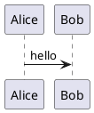
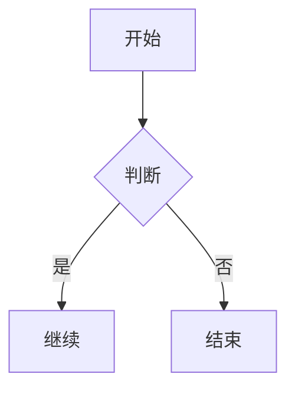

# 通过 Tailscale 使用 MCP 管理博客

MCP 服务作为 Django 管理命令运行，使用标准输入输出，不监听 HTTP 端口。客户端通过 `tailscale ssh` 在部署主机启动它；访问权限由 Tailscale SSH 策略、目标系统账号及 Docker 权限控制。不要把此命令包装为公网 HTTP 服务。可以按需限制 Tailscale SSH 策略中的来源设备和目标账号。

## 部署准备

1. 将代码和 `requirements.txt` 部署到运行博客的容器，安装依赖并重启或重建容器。容器必须访问与网站相同的 SQLite 数据库和内容目录。`SINGLE_BLOG=True` 且数据库必须恰好有一个博客，否则命令拒绝启动。
2. 标准部署会在应用镜像中安装 Java、PlantUML、Graphviz 和中文字体，并将 `PLANTUML_JAR` 指向 jar；自定义镜像需提供相同依赖和环境变量。仅普通 Markdown 时不需要 Java 或 jar。
3. PlantUML 图片存入网站的 SQLite 数据库。确保 `MAIN_SITE_HOSTS` 的首个域名是读者可以访问的公开域名，以生成可访问的图片 URL。
4. 确认客户端已登录同一个 tailnet，并可使用 Tailscale SSH 登录部署主机。下面的 `root@deploy`、容器名和目录应按实际部署调整；使用的账号需要运行 Docker Compose 的权限。不要将 SSH 登录欢迎信息输出到标准输出，否则会破坏 MCP 消息。

支持 stdio 的 MCP 客户端可以使用以下配置（字段名称视客户端而定）：

```json
{
  "mcpServers": {
    "bearblog": {
      "command": "tailscale",
      "args": ["ssh", "root@deploy", "cd /opt/bearblog && docker compose exec -T bearblog python manage.py publishing_mcp"]
    }
  }
}
```

首次连接前应在终端完成 Tailscale 登录及 SSH 授权，避免交互提示干扰 MCP。每次客户端连接会启动一个独立进程；关闭连接即结束该进程。拥有该 SSH 和容器权限的人可以操作博客，Tailscale 本身不会替代访问策略。

## 工具

| 工具 | 常用操作 |
| --- | --- |
| `get_blog_info` | 查看博客首页、文章列表、订阅源地址、导航和写作模板。 |
| `list_posts` | 按最后修改时间倒序列出内容，支持标题、slug 或 Markdown 关键词搜索（`query`），以及 `status`（`all` / `draft` / `published`）、`kind`（`article` / `page` / `all`）、`include_tags`、`exclude_tags`、`limit`（1–200）、`offset`（从 0 开始）。默认列出最近 200 篇文章（含草稿，不含独立页面）；标签精确匹配。 |
| `list_tags` | 列出文章标签和使用次数，支持按发布状态筛选和分页，默认只统计已标为发布的文章。 |
| `get_post` | 按 `uid` 或 `slug` 读取文章或独立页面的 Markdown、发布状态和 `last_modified`；二选一。 |
| `get_preview_link` | 按 `uid` 取预览链接。草稿链接含访问令牌，**任何持有该链接的人都可查看草稿**，不要公开分享。普通读取和列表不会返回草稿预览令牌。 |
| `create_post` | 创建文章，`is_page: true` 可创建独立页面。默认保存为草稿，明确传 `published: true` 才发布。 |
| `update_post` | 只修改传入的字段；不传 `published` 就保留原发布状态，传 `tags: []` 可清空标签。必须传 `uid` 和 `expected_modified`。 |
| `set_post_status` | 只变更发布状态：`draft` 隐藏文章，`published` 发布或恢复。必须传 `uid` 和 `expected_modified`。 |

### 隐藏文章（转为草稿）

1. 用 `get_post` 按 slug 或 UID 读取文章，拿到 `uid` 和 `last_modified`。
2. 调用 `set_post_status`，传入该 `uid`、把 `last_modified` 原样作为 `expected_modified`，并设置 `status: "draft"`。如果文章已被其他编辑更新，工具会拒绝写入；请先重新读取。
3. 草稿不会出现在首页、文章列表、RSS 或站点地图，普通文章链接返回 404。正文、slug、标签和已有发布日期都保留。恢复时重新读取文章，再调用同一工具设置 `status: "published"`。已被第三方保存的副本和已发出的草稿预览链接不会因此失效。

其他常用调用参数：

- 找首页「优选」文章：`list_posts({"status":"published","include_tags":["优选"]})`。MCP 的 `published` 按发布开关过滤；首页还会按发布日期过滤掉未来日期的文章。
- 查找待发文章：`list_posts({"status":"draft","query":"数据库","limit":20})`。
- 只改标签：`update_post({"uid":"…","expected_modified":"…","tags":["优选","数据库"]})`。
- 维护独立页面：先用 `list_posts({"kind":"page"})` 或 `get_post({"slug":"about"})` 定位，再用 `update_post` 局部修改。

### Markdown 和图表

正文中的 ` ```plantuml ` 代码块会用本地 PlantUML 转成 PNG，并替换为 Markdown 图片链接。例如：

````markdown

````

渲染在 PlantUML 的 `SECURE` 模式下进行，不支持依赖本地文件或远程 URL 的 include。渲染或数据库写入失败时文章不会保存；图片和文章保存在同一数据库事务中。SQLite 数据库是文章的主要存储；内容快照是否自动导出取决于 `PERSONAL_CONTENT_AUTO_EXPORT`，详见 [CONTENT.md](CONTENT.md)。

正文中的 ` ```mermaid ` 代码块不会在服务器端转换，而是原样保存，由读者浏览器渲染。页面中存在图表时才会从 jsDelivr 加载 Mermaid 11（流程图、时序图等），并跟随读者系统的浅色/深色主题；脚本加载失败时代码块保持原样显示。例如：

````markdown

````

Mermaid 语法错误只会让对应图表显示为错误提示，不影响文章其余内容。

验证：

```bash
python manage.py test blogs.test_mcp_publishing
```
