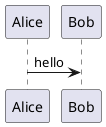

# 通过 Tailscale 发布文章

MCP 服务作为 Django 管理命令运行，使用标准输入输出，不监听 HTTP 端口。客户端通过 `tailscale ssh` 在部署主机启动它；访问权限由 Tailscale SSH 策略、目标系统账号及 Docker 权限控制。不要把此命令包装为公网 HTTP 服务。可以按需限制 Tailscale SSH 策略中的来源设备和目标账号。

## 部署准备

1. 将代码和 `requirements.txt` 部署到运行博客的容器，安装依赖并重启或重建容器。容器必须访问与网站相同的 SQLite 数据库和内容目录。`SINGLE_BLOG=True` 且数据库必须恰好有一个博客，否则命令拒绝启动。
2. 标准部署会在应用镜像中安装 Java、PlantUML、Graphviz 和中文字体，并将 `PLANTUML_JAR` 指向 jar；自定义镜像需提供相同依赖和环境变量。仅普通 Markdown 时不需要 Java 或 jar。
3. PlantUML 图片存入网站的 SQLite 数据库。确保 `MAIN_SITE_HOSTS` 的首个域名是读者可以访问的公开域名，以生成可访问的图片 URL。
4. 确认客户端已登录同一个 tailnet，并可使用 Tailscale SSH 登录部署主机。下面的 `root@deploy`、容器名和目录应按实际部署调整；使用的账号需要运行 Docker Compose 的权限。不要将 SSH 登录欢迎信息输出到标准输出，否则会破坏 MCP 消息。

支持 stdio 的 MCP 客户端可以使用以下配置（字段名称视客户端而定）：

```json
{
  "mcpServers": {
    "bearblog": {
      "command": "tailscale",
      "args": ["ssh", "root@deploy", "cd /opt/bearblog && docker compose exec -T bearblog python manage.py publishing_mcp"]
    }
  }
}
```

首次连接前应在终端完成 Tailscale 登录及 SSH 授权，避免交互提示干扰 MCP。每次客户端连接会启动一个独立进程；关闭连接即结束该进程。拥有该 SSH 和容器权限的人可以操作博客，Tailscale 本身不会替代访问策略。

## 工具

- `list_posts`：列出最近最多 200 篇文章和草稿。
- `get_post`：按 UID 读取文章正文和 `last_modified`。
- `create_post`：创建文章；`published` 默认 `false`，明确设为 `true` 才发布。`slug` 为站内路径，`tags` 为字符串数组。
- `update_post`：替换标题、slug、正文、标签和发布状态。必须提供 `get_post` 返回的 `last_modified`，以检测已经发生的修改；请先读取现有文章再更新。

正文中的 ` ```plantuml ` 代码块会用本地 PlantUML 转成 PNG，并替换为 Markdown 图片链接。例如：

````markdown

````

渲染在 PlantUML 的 `SECURE` 模式下进行，不支持依赖本地文件或远程 URL 的 include。渲染或数据库写入失败时文章不会保存；图片和文章保存在同一数据库事务中。SQLite 数据库是文章的主要存储；内容快照是否自动导出取决于 `PERSONAL_CONTENT_AUTO_EXPORT`，详见 [CONTENT.md](CONTENT.md)。

验证：

```bash
python manage.py test blogs.test_mcp_publishing
```
